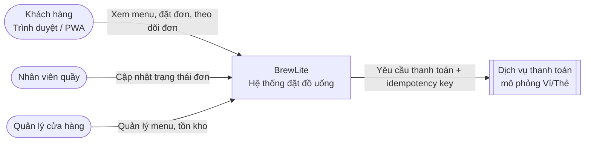
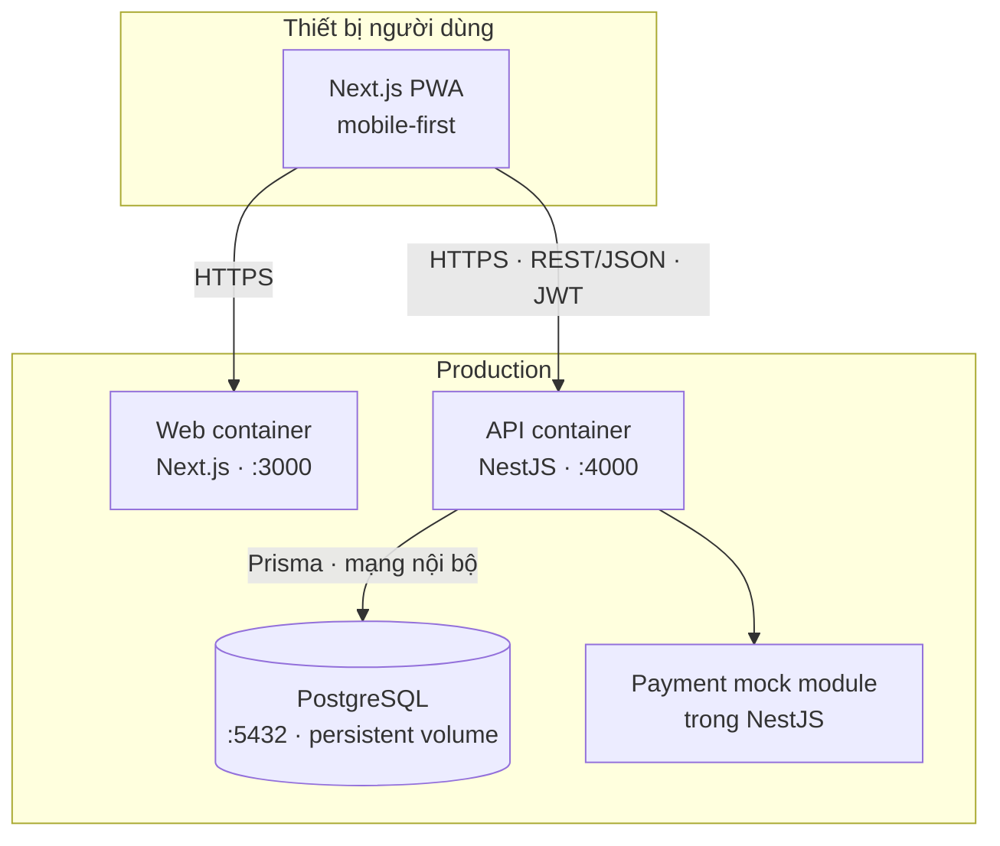

# Task 3.1 – Kiến trúc hệ thống BrewLite

> Phiên bản: 1.0 · Trạng thái: Sprint 1 · Mọi thay đổi phải đi qua Pull Request (xem `CONTRIBUTING.md`).

## 1. Phương pháp

Dùng **C4 model** (Context → Container → Component) để mô tả hệ thống, và **kiến trúc phân lớp theo module/domain** ở backend. Các quyết định quan trọng được ghi thành ADR trong [`adr/`](./adr).

## 2. C4 – Level 1: System Context

## 3. C4 – Level 2: Container

| Container | Công nghệ | Thư mục mã nguồn | Trách nhiệm |
|---|---|---|---|
| Web (PWA) | Next.js 16, React 19, Tailwind 4 | `frontend/brewlite` (*tương đương `apps/web`*) | Giao diện mobile-first, menu, giỏ hàng, theo dõi đơn |
| API | NestJS 12, TypeScript | `backend/brew-lite` (*tương đương `apps/api`*) | REST API, xác thực JWT, nghiệp vụ đơn hàng, thanh toán mô phỏng |
| Database | PostgreSQL 15 + Prisma | `backend/prisma/schema.prisma` | Lưu User, Product, Order, OrderItem, Payment |

## 4. C4 – Level 3: Component

### 4.1 Frontend (`frontend/brewlite`)

| Lớp | Thư mục | Ví dụ |
|---|---|---|
| Presentation (route) | `app/` | `page.tsx` (menu), `checkout/page.tsx`, `orders/page.tsx`, `orders/[id]/page.tsx`, `layout.tsx`, `globals.css` |
| UI components | `components/` | `MenuScreen`, `ProductCard`, `ProductSheet`, `CartSheet`, `MenuStates`, `CheckoutScreen`, `OrdersScreen`, `OrderDetailScreen`, `OrderLines`, `OrderStatusBadge`, `SubPageHeader` |
| State | `components/CartProvider.tsx`, `components/OrdersProvider.tsx`, `lib/cart.ts` | Giỏ hàng (reducer thuần, lưu `localStorage`) và danh sách đơn (đặt/thanh toán/đồng bộ trạng thái) |
| Data access | `lib/api.ts` | `getProducts`, `getProduct`, `createOrder`, `getOrders`, `getOrder`, `payOrder` – dùng mock khi chưa có `NEXT_PUBLIC_API_URL` |
| Domain/util | `lib/types.ts`, `lib/orders.ts`, `lib/format.ts`, `lib/menu-options.ts` | Kiểu dữ liệu, nghiệp vụ đơn (tính tiền, validate, idempotency key), định dạng VND, size/topping |

### 4.2 Backend (`backend/brew-lite/src`) – module theo domain

| Module | Trạng thái | Nội dung |
|---|---|---|
| `products` | ✅ Sprint 1 | `GET /products`, `GET /products/:id` (+ lọc `category`, `q`) |
| `health` | ✅ Sprint 1 | `GET /health` |
| `auth` | Sprint 2 | Đăng ký/đăng nhập, JWT guard |
| `orders` | Sprint 2 – phía backend | Tạo đơn trong transaction, trừ tồn kho, trạng thái đơn. Giao diện gọi `POST /orders`, `GET /orders`, `GET /orders/:id`. |
| `payments` | Sprint 2 – phía backend | Thanh toán Ví/Thẻ mô phỏng, idempotency key (`POST /payments`) |

Mỗi module gồm `controller` (HTTP) → `service` (nghiệp vụ) → truy cập dữ liệu (Prisma ở Sprint 2). Controller không chứa nghiệp vụ.

## 5. Các mối quan tâm xuyên suốt

| Chủ đề | Cách thực hiện |
|---|---|
| **Migration** | Prisma Migrate (`prisma migrate deploy` trong pipeline, chạy trước khi khởi động API mới) + seed để tái tạo DB. Sprint 1 dùng seed in-memory. |
| **Cấu hình** | Biến môi trường (`.env`, không commit). `.env.example` liệt kê đủ biến. Secret production nằm ở CI/nền tảng deploy. |
| **Logging** | Logger mặc định của NestJS, ghi ra stdout để nền tảng thu log; không log secret/mật khẩu. |
| **Health check** | `GET /health` trả `{status:"ok"}`; dùng cho smoke test sau deploy và health check của nền tảng. |
| **CORS** | Cho phép origin của web qua `CORS_ORIGIN`. |
| **Thanh toán** | Module mô phỏng trong API; mọi yêu cầu thanh toán mang `idempotencyKey` (đã có `Payment.idempotencyKey @unique`). |
| **Bảo mật** | JWT, băm mật khẩu, validate đầu vào ở cả frontend và backend, DB không public. |

## 6. Lý do chọn, ưu điểm, hạn chế, trade-off

| Quyết định | Ưu điểm | Hạn chế / Trade-off |
|---|---|---|
| Monorepo (web + api + docs) | Một PR có thể đổi cả hai phía; CI/traceability tập trung | CI phải chạy theo đường dẫn để không tốn thời gian |
| Modular monolith (NestJS) thay vì microservices | Đơn giản, đủ cho phạm vi môn học, dễ test/deploy | Khó scale từng phần độc lập (chấp nhận được với MVP) |
| Next.js PWA | Mobile-first, cài được như app, SSR/SSG tốt | Thêm độ phức tạp so với SPA thuần |
| PostgreSQL + Prisma | Giao dịch ACID cho đơn/tồn kho, schema có kiểu, migration rõ ràng | Cần quản lý migration cẩn thận khi nhiều người sửa schema |
| Thanh toán mô phỏng nội bộ | Không phụ thuộc bên thứ ba, test được nhánh thất bại | Không phản ánh tích hợp cổng thanh toán thật |

## 7. Truy vết thành phần

Mỗi container trong [deployment diagram](../diagrams/deployment.puml) tương ứng một mục ở bảng §3 và thư mục mã nguồn ở cột "Thư mục mã nguồn". Xem thêm [`../deployment.md`](../deployment.md).
