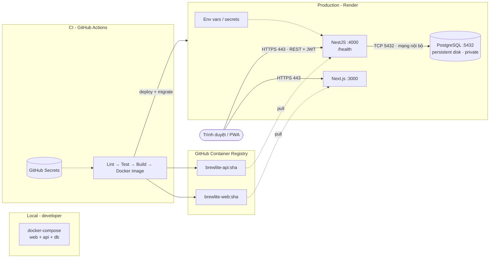

# Task 3.2 – Deployment diagram

Nguồn PlantUML: [`deployment.puml`](./deployment.puml). Xuất ảnh để nộp: `plantuml -tsvg docs/diagrams/deployment.puml` (hoặc dùng extension *PlantUML* trong VS Code → Export). Bản Mermaid dưới đây hiển thị trực tiếp trên GitHub.

## Truy vết

| Thành phần trong sơ đồ | Mô tả kiến trúc | Mã nguồn |
|---|---|---|
| Next.js :3000 | architecture.md §3–4.1 | `frontend/brewlite` |
| NestJS :4000 | architecture.md §3–4.2 | `backend/brew-lite` |
| PostgreSQL :5432 | architecture.md §3, §5 | `backend/prisma/schema.prisma`, `docker-compose.yml` |
| GitHub Actions | architecture.md §5 | `.github/workflows/ci.yml` |
| Registry / Render | ADR-006 | *(Task 5: workflow CD, Dockerfile)* |

> Lưu ý: sơ đồ nền tảng (Render + GHCR) là **đề xuất** theo ADR-006. Khi nhóm chốt nền tảng thật, cập nhật lại sơ đồ này.
